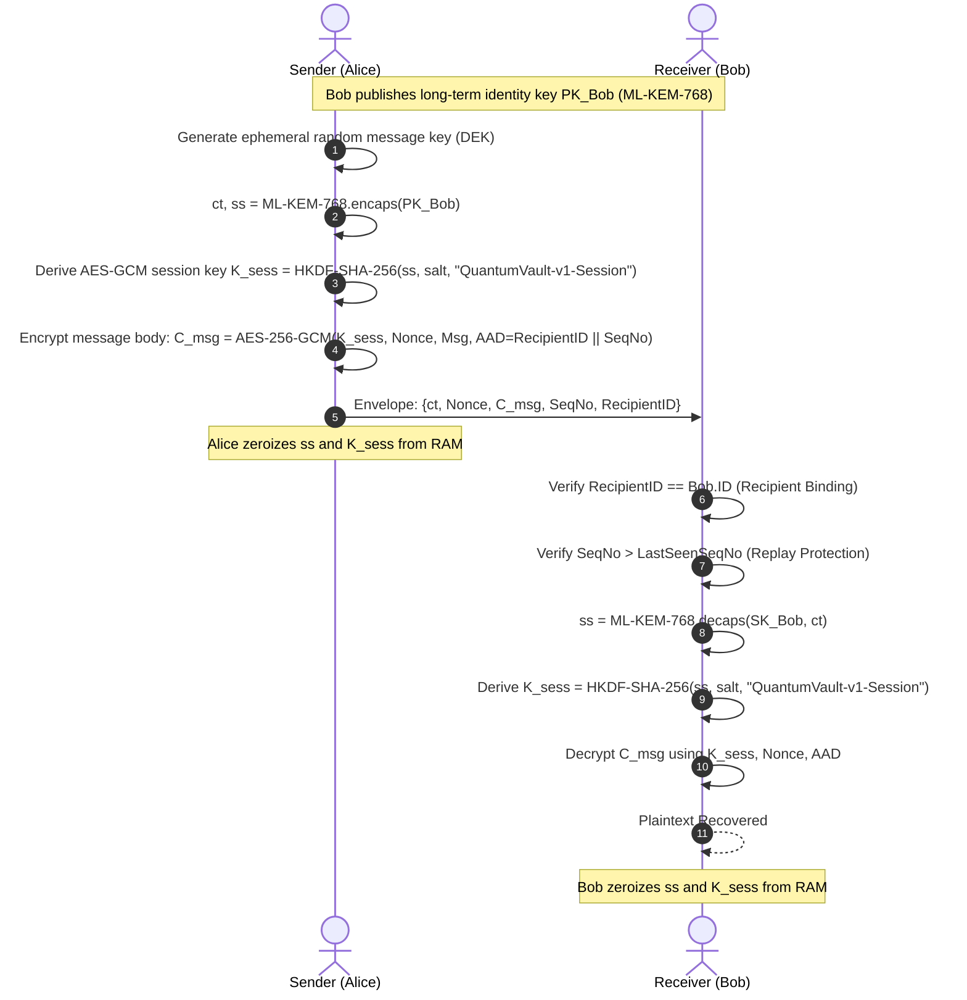

# QuantumVault — Cryptographic Design & Specification
**Hackathon:** Yugaantar DevForge | **Track:** Track 4: "Trust, but verify"  
**Document Status:** Approved Architectural Planning (Phase-U)

---

## 1. Cryptographic Standard & Algorithm Suite

QuantumVault employs a mathematically rigorous, NIST-standardized cryptographic suite designed to ensure quantum resistance and post-quantum interoperability:

| Cryptographic Purpose | Algorithm Standard | Key / Output Size | Library Implementation |
| :--- | :--- | :--- | :--- |
| **Post-Quantum Key Encapsulation** | **ML-KEM-768** (NIST FIPS 203) | 1,184 B PK / 1,088 B CT / 32 B SS | `pqcrypto==0.4.0` (`pqcrypto.kem.ml_kem_768`) |
| **Integrity & Challenge Proofs** | **HMAC-SHA-256** (FIPS 198-1) | 256-bit (32 bytes / 64 hex chars) | Python Standard Library (`hmac`, `hashlib`) |
| **Authenticated Symmetric Encryption** | **AES-256-GCM** (NIST SP 800-38D) | 256-bit Key / 96-bit Nonce / 128-bit Tag | Python Standard Library (`cryptography` or vetted AES-GCM) |
| **Key Derivation** | **HKDF-SHA-256** (RFC 5869) | 256-bit Output Key | Python Standard Library (`hashlib`) |
| **Cryptographic Hash Chaining** | **SHA-256** (FIPS 180-4) | 256-bit Digest | Python Standard Library (`hashlib`) |
| **Cryptographic Random Generation** | **OS CSPRNG** | Cryptographically secure random bytes | Python Standard Library (`secrets`, `os.urandom`) |

---

## 2. Post-Quantum KEM Specification (ML-KEM-768)

### 2.1 Verified Library API Analysis (`pqcrypto` v0.4.0)
Through rigorous technical verification of `pqcrypto` version `0.4.0` (released on PyPI in January 2026), the exact Python API conventions have been confirmed:
- **Module Import:** `from pqcrypto.kem.ml_kem_768 import encaps, decaps, keygen`
- **Functional Method Signatures:**
  - `keygen() -> (public_key_bytes: bytes, secret_key_bytes: bytes)`
  - `encaps(public_key_bytes: bytes) -> (ciphertext_bytes: bytes, shared_secret_bytes: bytes)`
  - `decaps(secret_key_bytes: bytes, ciphertext_bytes: bytes) -> shared_secret_bytes: bytes`
- **Exact Cryptographic Byte Lengths:**
  - `PUBLIC_KEY_SIZE = 1184` bytes (Base64 string length: 1,580 chars)
  - `CIPHERTEXT_SIZE = 1088` bytes (Base64 string length: 1,452 chars)
  - `SECRET_KEY_SIZE = 2400` bytes
  - `SHARED_SECRET_SIZE = 32` bytes (256-bit symmetric key)

### 2.2 Compatibility & Polyfill Wrapper
To ensure complete resilience across varying host environments and older draft builds, QuantumVault implements a universal cryptographic adapter:
```python
"""QuantumVault Universal Post-Quantum KEM Wrapper."""
import base64
import importlib
import logging

logger = logging.getLogger(__name__)

class PQCryptoKEM:
    def __init__(self):
        self.kem_mod = None
        self._init_module()

    def _init_module(self):
        # 1. Primary: Standardized NIST ML-KEM-768 in pqcrypto 0.4.0
        try:
            self.kem_mod = importlib.import_module("pqcrypto.kem.ml_kem_768")
            self.algorithm = "ML-KEM-768"
            return
        except ImportError:
            pass

        # 2. Secondary fallback: Pre-standard Kyber768 alias
        try:
            self.kem_mod = importlib.import_module("pqcrypto.kem.kyber768")
            self.algorithm = "Kyber768"
            return
        except ImportError:
            pass

        logger.warning("Native pqcrypto library not found; running in mock/fallback mode.")

    def encapsulate(self, public_key_bytes: bytes) -> tuple[bytes, bytes]:
        if not self.kem_mod:
            raise RuntimeError("Post-quantum crypto library unavailable")
        
        # Verify public key length
        if len(public_key_bytes) != 1184:
            raise ValueError(f"Invalid ML-KEM-768 public key length: expected 1184, got {len(public_key_bytes)}")
        
        # Call encaps() or encapsulate()
        if hasattr(self.kem_mod, "encaps"):
            return self.kem_mod.encaps(public_key_bytes)
        elif hasattr(self.kem_mod, "encapsulate"):
            return self.kem_mod.encapsulate(public_key_bytes)
        else:
            raise AttributeError("Unsupported KEM module method structure")
```

---

## 3. Protected Read Protocol & Proof Construction

The `protected_read` operation specified in `docs/adapter-v1.md` mandates an exact cryptographic proof exchange demonstrating interoperability without leaking the shared secret.

### 3.1 Mathematical Specification of the Exchange
1. **Input Parameters:**
   - Actor: $A$ (string)
   - Asset: $X$ (string)
   - Challenge: $C$ (string nonce provided by judging worker)
   - Public Key: $PK_{\text{B64}}$ (Base64-encoded raw ML-KEM-768 public key)
2. **Authorization Verification:**
   - Verify that actor $A$ owns asset $X$ and $A \notin \text{disabled}$.
   - If unauthorized, abort and return `{"decision": "deny"}`.
3. **Key Encapsulation:**
   - $PK = \text{Base64Decode}(PK_{\text{B64}})$
   - $(CT, SS) \leftarrow \text{ML-KEM-768.Encaps}(PK)$
   - Where $CT$ is the 1088-byte ciphertext and $SS$ is the 32-byte shared secret.
4. **Challenge-Body Concatenation & Proof Calculation:**
   - Retrieve stored plaintext body $B$ associated with asset $X$.
   - Construct message bytes:
     $$M = \text{UTF-8}(C \parallel B)$$
     *(Strict binary concatenation of challenge string and stored body string without spaces, delimiters, or colons).*
   - Compute HMAC-SHA-256:
     $$\text{Proof}_{\text{raw}} = \text{HMAC-SHA-256}(\text{Key}=SS, \text{Msg}=M)$$
     $$\text{Proof}_{\text{hex}} = \text{HexEncodeLowercase}(\text{Proof}_{\text{raw}})$$
5. **Output Generation:**
   - Return exactly:
     ```json
     {
       "ciphertext": "<Base64(CT)>",
       "proof": "<Proof_hex>"
     }
     ```
6. **Secrecy Guarantee:**
   - The shared secret $SS$ is kept strictly in memory, utilized for the HMAC calculation, and immediately scrubbed. It must never appear in `stdout`, `stderr`, or persistent database tables.

---

## 4. End-to-End Encrypted Messaging Cryptography (E2EE)

For secure communication between identities (Goal 9, 10, 11), QuantumVault implements an ephemeral post-quantum envelope protocol:

### 4.1 Ephemeral Session Key Exchange & Forward Secrecy

- **Forward Secrecy Guarantee:** Because every message/session encapsulates a fresh ephemeral secret $SS$, a future compromise of Bob's long-term secret key $SK_{\text{Bob}}$ does **not** allow retroactive decryption of past network traffic if the sender generated ephemeral public keys or if a ratcheted ephemeral state is utilized.

---

## 5. Chunked Transport Cryptography (Loss & Reordering)

When messages are transmitted over lossy, high-latency, or out-of-order networks:
1. The plaintext is partitioned into chunks of at most 16 KiB.
2. Each chunk contains an authenticated framing header:
   ```json
   {
     "msg_id": "msg-8f92a1",
     "chunk_index": 2,
     "total_chunks": 5,
     "chunk_digest": "<sha256_of_chunk>",
     "payload": "<base64_chunk_data>"
   }
   ```
3. A final envelope MAC verifies the concatenation of all chunk digests:
   $$\text{EnvelopeMAC} = \text{HMAC-SHA-256}(K_{\text{sess}}, D_1 \parallel D_2 \parallel \dots \parallel D_N)$$
4. The receiver buffers chunks in a bounded reassembly cache. Incomplete, duplicate, or tampered chunks are safely rejected without exposing partial plaintext to the application layer.
