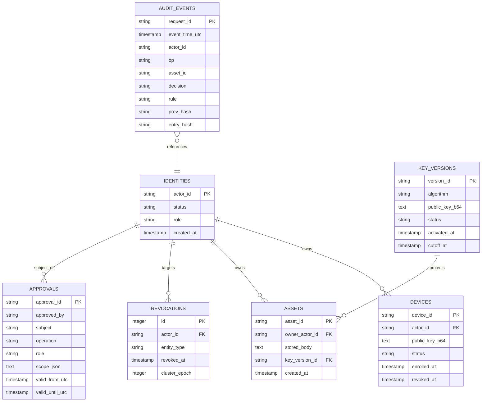

# QuantumVault — Database Schema & Persistence Specification
**Hackathon:** Yugaantar DevForge | **Track:** Track 4: "Trust, but verify"  
**Document Status:** Approved Architectural Planning (Phase-U)

---

## 1. Persistence Philosophy & Technology Selection

QuantumVault relies on **SQLite 3** operating in **Write-Ahead Logging (WAL) mode** as its core transactional persistence layer.

### Why SQLite WAL Mode?
1. **Zero External Server Dependency:** Conforms 100% to the offline, sandboxed Linux container constraints. No daemon or background database service required.
2. **Process Crash Safety:** SQLite WAL mode with `PRAGMA synchronous = FULL` or `NORMAL` guarantees ACID properties. An unexpected process kill (`SIGKILL`) or power loss leaves the database in a cleanly recoverable state without corruption.
3. **High-Performance Multi-Process Concurrency:** Supports multiple read processes executing concurrently with write transactions.
4. **State Directory Portability:** The single database file `quantumvault.db` resides cleanly inside `TRACK4_STATE_DIR` or the OS temporary directory, matching the official adapter contract.

---

## 2. Pragmas & Connection Initialization

Every process initialization executes:
```sql
PRAGMA journal_mode = WAL;
PRAGMA synchronous = NORMAL;
PRAGMA foreign_keys = ON;
PRAGMA busy_timeout = 5000;
PRAGMA temp_store = MEMORY;
```

---

## 3. Entity-Relationship Diagram (ERD)



---

## 4. DDL Table Definitions

### 4.1 Global Cluster & Application State (`app_state`)
```sql
CREATE TABLE IF NOT EXISTS app_state (
    key TEXT PRIMARY KEY,
    value TEXT NOT NULL,
    updated_at TIMESTAMP DEFAULT CURRENT_TIMESTAMP
);

-- Initial records:
-- ('cluster_epoch', '1')
-- ('active_key_version', 'v1')
-- ('initialized_at', '2026-11-26T15:00:00Z')
-- ('synthetic_marker', '<marker_token>')
```

### 4.2 Identities Table (`identities`)
```sql
CREATE TABLE IF NOT EXISTS identities (
    actor_id TEXT PRIMARY KEY,
    role TEXT NOT NULL DEFAULT 'viewer',
    status TEXT NOT NULL CHECK(status IN ('active', 'disabled')),
    created_at TIMESTAMP DEFAULT CURRENT_TIMESTAMP,
    updated_at TIMESTAMP DEFAULT CURRENT_TIMESTAMP
);

CREATE INDEX IF NOT EXISTS idx_identities_status ON identities(status);
```

### 4.3 Devices Table (`devices`)
```sql
CREATE TABLE IF NOT EXISTS devices (
    device_id TEXT PRIMARY KEY,
    actor_id TEXT NOT NULL REFERENCES identities(actor_id) ON DELETE CASCADE,
    public_key_b64 TEXT,
    status TEXT NOT NULL CHECK(status IN ('active', 'revoked')),
    enrolled_at TIMESTAMP DEFAULT CURRENT_TIMESTAMP,
    revoked_at TIMESTAMP
);

CREATE INDEX IF NOT EXISTS idx_devices_actor ON devices(actor_id, status);
```

### 4.4 Assets & Vault Resources (`assets`)
```sql
CREATE TABLE IF NOT EXISTS assets (
    asset_id TEXT PRIMARY KEY,
    owner_actor_id TEXT NOT NULL REFERENCES identities(actor_id),
    stored_body TEXT NOT NULL,
    key_version_id TEXT DEFAULT 'v1',
    created_at TIMESTAMP DEFAULT CURRENT_TIMESTAMP,
    updated_at TIMESTAMP DEFAULT CURRENT_TIMESTAMP
);

CREATE INDEX IF NOT EXISTS idx_assets_owner ON assets(owner_actor_id);
```

### 4.5 Revocations Table (`revocations`)
```sql
CREATE TABLE IF NOT EXISTS revocations (
    id INTEGER PRIMARY KEY AUTOINCREMENT,
    actor_id TEXT NOT NULL,
    entity_type TEXT NOT NULL CHECK(entity_type IN ('actor', 'device', 'role')),
    reason TEXT,
    cluster_epoch INTEGER NOT NULL,
    revoked_at TIMESTAMP DEFAULT CURRENT_TIMESTAMP
);

CREATE UNIQUE INDEX IF NOT EXISTS idx_revocations_actor ON revocations(actor_id, entity_type);
```

### 4.6 Cryptographic Audit Events (`audit_events`)
```sql
CREATE TABLE IF NOT EXISTS audit_events (
    request_id TEXT PRIMARY KEY,
    event_time_utc TEXT NOT NULL,
    actor_id TEXT NOT NULL,
    op TEXT NOT NULL,
    asset_id TEXT,
    decision TEXT NOT NULL CHECK(decision IN ('allow', 'deny')),
    rule TEXT NOT NULL,
    prev_hash TEXT NOT NULL,
    entry_hash TEXT NOT NULL
);

CREATE INDEX IF NOT EXISTS idx_audit_time ON audit_events(event_time_utc);
```

### 4.7 Key Lifecycle & Versions (`key_versions`)
```sql
CREATE TABLE IF NOT EXISTS key_versions (
    version_id TEXT PRIMARY KEY,
    algorithm TEXT NOT NULL DEFAULT 'ML-KEM-768',
    public_key_b64 TEXT NOT NULL,
    encrypted_secret_key TEXT,
    status TEXT NOT NULL CHECK(status IN ('pre_active', 'active', 'grace_period', 'retired')),
    activated_at TEXT NOT NULL,
    cutoff_at TEXT
);
```

### 4.8 Change Management Approvals (`approvals`)
```sql
CREATE TABLE IF NOT EXISTS approvals (
    approval_id TEXT PRIMARY KEY,
    approved_by TEXT NOT NULL,
    subject TEXT NOT NULL,
    operation TEXT NOT NULL,
    role TEXT NOT NULL,
    scope_json TEXT NOT NULL,
    valid_from_utc TEXT NOT NULL,
    valid_until_utc TEXT NOT NULL
);

CREATE INDEX IF NOT EXISTS idx_approvals_lookup ON approvals(subject, role, valid_from_utc, valid_until_utc);
```

### 4.9 Telemetry Ingestion Log (`telemetry_events`)
```sql
CREATE TABLE IF NOT EXISTS telemetry_events (
    event_id TEXT PRIMARY KEY,
    event_time_utc TEXT NOT NULL,
    received_time_utc TEXT NOT NULL,
    source_clock_offset_ms INTEGER NOT NULL DEFAULT 0,
    corrected_time_utc TEXT NOT NULL,
    actor TEXT NOT NULL,
    source_service TEXT NOT NULL,
    target_service TEXT NOT NULL,
    action TEXT NOT NULL,
    role_before TEXT,
    role_after TEXT,
    outcome TEXT NOT NULL,
    approval_id TEXT,
    session_id TEXT,
    correlation_id TEXT,
    label TEXT,
    reason TEXT
);

CREATE INDEX IF NOT EXISTS idx_telemetry_corrected_time ON telemetry_events(corrected_time_utc);
CREATE INDEX IF NOT EXISTS idx_telemetry_session ON telemetry_events(session_id, correlation_id);
```

---

## 5. Atomic State Transitions & Recovery Journaling

1. **Setup Clean Wipe Transaction:**
   ```sql
   BEGIN IMMEDIATE TRANSACTION;
   DELETE FROM assets;
   DELETE FROM identities;
   DELETE FROM revocations;
   DELETE FROM audit_events;
   DELETE FROM app_state;
   -- Insert fresh initial data
   INSERT INTO app_state (key, value) VALUES ('ready', 'true');
   COMMIT;
   ```
2. **Actor Revocation Transaction:**
   ```sql
   BEGIN IMMEDIATE TRANSACTION;
   INSERT OR IGNORE INTO revocations (actor_id, entity_type, cluster_epoch)
       VALUES (:actor, 'actor', (SELECT CAST(value AS INTEGER) + 1 FROM app_state WHERE key = 'cluster_epoch'));
   UPDATE identities SET status = 'disabled' WHERE actor_id = :actor;
   UPDATE app_state SET value = CAST(value AS INTEGER) + 1 WHERE key = 'cluster_epoch';
   COMMIT;
   ```
   *Guarantees atomic commit: The actor is marked disabled and recorded in revocations within a single atomic write.*
