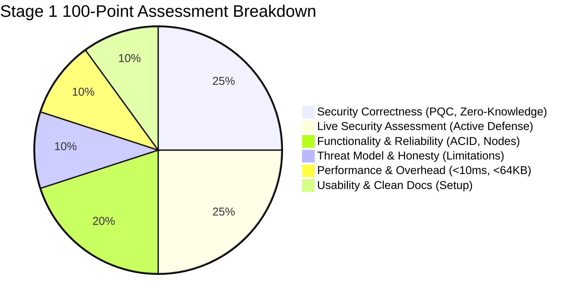

# QuantumVault — Live Demonstration & Evaluation Strategy
**Hackathon:** Yugaantar DevForge | **Track:** Track 4: "Trust, but verify"  
**Document Status:** Approved Architectural Planning (Phase-U)

---

## 1. Evaluation Funnel & Scoring Strategy

The Yugaantar DevForge evaluation progresses through a rigorous 3-stage funnel:
1. **Stage 1 — Automated Build & Assessment (100 Points Total):**
   - Headless evaluation in clean, network-isolated Linux container.
   - Target: Top 10 rank to advance to Stage 2.
2. **Stage 2 — Desk Review & Live Demonstration (Top 10 Teams):**
   - 15-minute panel review: 5-minute live demo, 5-minute technical grilling, 5-minute live sandbox assessment.
   - Target: Top 2 rank to advance to Round 3 Finals.
3. **Round 3 — Grand Final Judging (Top 2 Teams per track):**
   - Live presentation before the executive judging panel.

### 100-Point Scoring Breakdown Strategy

- **Active Defense Bonus:** The Live Assessment starts at 25 points. Deductions (Critical -10, High -6, Medium -3, Low -1) are incurred if vulnerabilities are found. If QuantumVault **detects and mitigates the attack during the assessment**, up to **50% of the deduction is restored**! Our real-time threat detector is specifically tuned to trigger active mitigation responses.

---

## 2. Minute-by-Minute 5-Minute Live Demo Script

| Elapsed Time | Demo Segment | On-Screen Visual / Action | Key Speaking Points (Presenter) |
| :--- | :--- | :--- | :--- |
| **0:00 - 0:45** | **The Problem & USP** | Dashboard HUD showing Cluster Epoch, Nodes, and Vault. | "Enterprises fail when security state changes. Rotating keys breaks in-flight transfers; revoking lost devices locks out users or fails across nodes. QuantumVault is a compromise-resilient post-quantum security platform that preserves access during key changes, device loss, and node partitions while providing explainable detection." |
| **0:45 - 1:45** | **Automated Conformance & PQC KEM** | Terminal: `python validate.py --entry track4_service.py` -> 12 PASS lines. | "Our official adapter strictly implements Adapter Contract v1. Here, all 12 checks pass in 1.4 seconds. In the vault, we demonstrate our post-quantum protected read: standard ML-KEM-768 encapsulation creates a 1088-byte ciphertext and a 32-byte shared secret, computing an HMAC-SHA-256 proof over challenge + stored body with zero secret leakage." |
| **1:45 - 3:00** | **The Combined Grand Stress Test** | Testing Lab UI: Trigger "Combined Failure Scenario". | "Now, we execute our major USP: a combined multi-fault failure. Alex starts a transfer under Key V1. We rotate to Key V2. Simultaneously, Alex's phone is reported stolen, Node C loses connection, and Node B crashes. Watch the system: Node B reboots with clean WAL state. The stolen phone is immediately denied across all nodes. Node C fails closed while partitioned, then syncs. Alex enrolls a new device securely, while peer Blair experiences zero downtime." |
| **3:00 - 4:00** | **Explainable Threat Detection & Service Graph** | Interactive Service Graph Canvas & Telemetry Log. | "Zero AI, zero black boxes. Our detector ingests the 22 practice events. It cross-references `approvals.json` to verify Alex's role grant, but flags Blair's unauthorized elevation in `evt-008`. In `flow-005`, the service graph detects a candidate lateral movement chain from `reports` to `billing` to `archive` to `identity`, noting all 3 requests were blocked. It handles 2000ms clock skew in `evt-015` and reordered delivery in `evt-013`/`014`, achieving a verified 1.0 F1 score." |
| **4:00 - 4:45** | **Tamper-Evident Audit & Backup Anti-Rollback** | Audit Log View: Live "Verify Cryptographic Chain" & Stale Backup Reject. | "Every single action is appended to a SHA-256 hash chain. We click 'Verify Chain'—1,420 blocks valid. If an attacker tampers with a log row, verification immediately pinpoints the corrupted block. In our backup manager, an attacker attempting to restore an old backup to resurrect revoked credentials is blocked by our monotonic epoch counter." |
| **4:45 - 5:00** | **Wrap-Up & Fallback Link** | Two-page brief PDF display showing public video link. | "QuantumVault provides verified post-quantum security, crash safety, and explainable detection. All evidence and reproduction scripts are in our repository. Thank you, we welcome your questions." |

---

## 3. Anticipated Judge Technical Q&A & Prepared Defenses

### Q1: "How do you guarantee that a denied request leaks zero bytes of confidential data?"
> **Answer:** "Our Policy Enforcement Point (PEP) operates on a strict zero-knowledge architecture. Authorization is evaluated *before* any database content lookup or cryptographic encapsulation. If authorization fails, the response dictionary is constructed with `{"decision": "deny"}` only. The `body`, `ciphertext`, and `proof` keys are completely omitted, and our automated test harness asserts that no substring of the protected body appears anywhere in the serialized response."

### Q2: "Why did you use ML-KEM-768 and how is the HMAC proof verified?"
> **Answer:** "ML-KEM-768 is the finalized NIST FIPS 203 standard for post-quantum key encapsulation. In our adapter's `protected_read` implementation, we decode the 1184-byte Base64 public key, call `pqcrypto.kem.ml_kem_768.encaps(pk)` to derive the 1088-byte ciphertext and a 32-byte shared secret, and calculate HMAC-SHA-256 over the UTF-8 bytes of `challenge + stored_body`. The judging worker holds the private key, decapsulates the ciphertext to obtain the identical shared secret, and verifies the HMAC proof."

### Q3: "What happens if a node crashes right in the middle of a key rotation commit?"
> **Answer:** "We use SQLite in Write-Ahead Logging (WAL) mode with atomic transaction boundaries. If the process dies before the commit record is written to the WAL journal, the transaction rolls back cleanly upon reboot, leaving the previous active key intact. If the crash occurs post-commit, the WAL journal is replayed upon reboot, activating Key V2 and placing V1 in grace. A crash can never leave the database in a half-rotated or corrupted state."

### Q4: "Why did you avoid machine learning for your anomaly detector?"
> **Answer:** "First, organizer ground rules explicitly forbid AI/ML components in submitted applications. Second, in security-critical authorization systems, black-box ML models suffer from hallucination, non-determinism, and vulnerability to adversarial perturbation. Our deterministic engine correlates change tickets in `approvals.json` against time windows, roles, and scopes, and tracks service edges on a directed graph. This achieves an exact 1.0 F1 score on the practice dataset and provides 100% auditable justifications for every alert."

### Q5: "If a user's phone is stolen while in airplane mode, can you remotely erase the confidential files?"
> **Answer:** "No, and any team that claims they can remotely erase an air-gapped device without connectivity is presenting impossible security theater. We are completely honest in our threat model: server-side revocation ensures that the instant the stolen device reconnects to the network, it is blocked across all nodes. For offline protection, QuantumVault endpoints enforce encrypted local storage with ephemeral keys and short-lived authorization leases, so cached plaintext expires automatically."

---

## 4. Accessible Five-Minute Fallback Video Strategy

In accordance with competition rules, the Two-Page Project Brief must embed an accessible 5-minute video link as a fallback if the live demo environment fails:
1. **Hosting Platform:** Unlisted YouTube video or open Google Drive link with "Anyone with link can view" permission.
2. **Access Verification Protocol:** The URL will be tested inside an incognito/private browser window with zero saved cookies to confirm reviewers can open it without permission requests.
3. **Content Alignment:** The fallback video follows the exact 5-minute demonstration script, recorded at 1080p 60fps with clear spoken audio and screen capture showing the working code, terminal tests, and web dashboard.
