# QuantumVault — Frontend Architecture & UI Blueprint
**Hackathon:** Yugaantar DevForge | **Track:** Track 4: "Trust, but verify"  
**Document Status:** Approved Architectural Planning (Phase-U)

---

## 1. Design Philosophy & User Experience Goals

QuantumVault's user interface is conceived as a high-assurance **enterprise cybersecurity control plane**, avoiding generic student hackathon aesthetics. 

### Core UI Principles:
1. **Zero Fabricated Metrics:** Every metric, node status, chart point, and log entry displayed on screen originates from verifiable backend API responses and database state.
2. **Deterministic Cryptographic Feedback:** The UI clearly distinguishes between:
   - Allowed vs. Denied access.
   - Verified post-quantum encapsulation vs. unauthenticated requests.
   - Active keys vs. Grace period keys vs. Retired keys.
   - Synchronized nodes vs. Disconnected / Fail-closed nodes.
3. **High-Density, Low-Distraction Theme:** Dark enterprise cybersecurity palette (Tailwind slate-950 background, subtle border grays, emerald-500 verified indicators, amber-500 warnings, and rose-500 alerts). No gratuitous animations or distracting decorative gradients.
4. **Air-Gapped Local Operation:** All assets (Tailwind, Lucide icons, fonts, charting libraries) are bundled locally in the Vite build; zero external CDN dependencies.

---

## 2. Frontend Technology Stack

- **Framework:** React 18+ (Functional components with Hooks).
- **Build Tool:** Vite (Fast HMR, optimized production build).
- **Styling:** Tailwind CSS (Utility-first styling with custom cybersecurity theme).
- **Iconography:** `lucide-react` (Crisp, modern SVG icons).
- **Service Graph Visualization:** `@xyflow/react` (React Flow) or locally bundled SVG graph renderer for interactive service-edge inspection.
- **Charts & Telemetry Graphs:** `recharts` (Time-series latency, F1 confusion matrix, clock skew distributions).
- **State Management:** Lightweight React Context or Zustand for auth, vault, and testing state.

---

## 3. Dual-Portal Information Architecture

```mermaid
graph TD
    Root["QuantumVault Application Shell"]
    Root --> TopBar["Navigation Header (Role Switcher & Cluster Health)"]
    
    Root --> UserPortal["User Portal (End-User Experience)"]
    UserPortal --> VaultView["My Secure Vault (Encrypted Files)"]
    UserPortal --> MessagingView["E2EE Secure Messaging"]
    UserPortal --> DeviceView["Registered Devices & Lost-Device Reporting"]
    UserPortal --> ActivityView["Personal Access Activity"]

    Root --> OperatorPortal["Security Operator Portal (Admin Console)"]
    OperatorPortal --> Overview["Executive Security Overview"]
    OperatorPortal --> IAMView["Identity, Roles & Approvals"]
    OperatorPortal --> KeyMgmtView["Post-Quantum Key Lifecycle & Rotation"]
    OperatorPortal --> NodeClusterView["Distributed Node Health & Revocation Sync"]
    OperatorPortal --> GraphView["Service Graph & Lateral Movement Detector"]
    OperatorPortal --> AuditView["Tamper-Evident Audit Log & Hash Verifier"]
    OperatorPortal --> BackupView["Authenticated Backup & Anti-Rollback Manager"]
    OperatorPortal --> BenchmarkView["Detection Metrics & Confusion Matrix"]
    OperatorPortal --> LabView["Interactive Security Testing Laboratory"]
```



---

## 4. Key View Specifications

### 4.1 User Portal: My Secure Vault
- **Asset List:** Displays owned resources with metadata (`asset_id`, size, key version, last modified).
- **Upload Dropzone:** Allows dragging files; automatically creates asset entry, derives DEK, and stores encrypted payload.
- **Protected Read Trigger:** Demonstrates post-quantum read interoperability:
  - Generates fresh challenge string.
  - Submits public key to backend.
  - Displays returned Base64 ciphertext and hex HMAC proof.
  - Visual badge: `ML-KEM-768 Encapsulated | Proof Verified`.

### 4.2 User Portal: Device Management & Lost Device Reporting
- **Device List:** Displays active devices bound to user account (e.g. `Laptop-MacBook`, `Phone-Android`).
- **One-Click Revocation:** Prominent red button: **"Report Device Lost / Stolen"**.
  - Clicking prompts for confirmation.
  - Immediately invokes `/api/device/report-lost`.
  - UI updates badge to `REVOKED` in real time.
- **Replacement Enrolment:** Clean wizard to generate new device keypair and enroll fresh replacement hardware without reactivating the lost credential.

### 4.3 Operator Portal: Executive Security Overview
- **Header HUD:** Displays Cluster Epoch Counter, Active Key Version (`v2`), Revocation Count, Active Nodes (3/3), and Unresolved Alerts (0).
- **Status Cards:**
  - PQC KEM Engine: `Online (ML-KEM-768 / FIPS 203)`.
  - Database WAL Status: `Healthy (WAL Checkpoint Synchronized)`.
  - Audit Log Integrity: `Verified (Hash Chain Valid)`.

### 4.4 Operator Portal: Interactive Service Graph & Lateral Movement
- **Visual Graph Canvas (React Flow):**
  - Renders enterprise service nodes (`portal`, `catalog`, `reports`, `billing`, `archive`, `identity`).
  - Green solid lines represent baseline approved communication edges.
  - Pulsing amber/red dashed lines represent anomalous traversals.
- **Incident Inspector Drawer:** Clicking an anomalous edge opens a slide-over drawer displaying:
  - Associated `flow_id` and `session_id`.
  - Sequential hops with timestamps.
  - Enforcement outcome (e.g. `BLOCKED at reports -> billing`).
  - Recommended action button: `Isolate Service Account`.

### 4.5 Operator Portal: Tamper-Evident Audit Log Viewer
- **Search & Filter:** Query by actor, action, decision (`allow`/`deny`), date range.
- **Hash Chain Verification Widget:** Prominent top banner with a **"Verify Cryptographic Chain"** button.
  - When clicked, backend calculates $\text{SHA-256}(H_{N-1} \parallel \text{Row}_N)$ across the entire database.
  - Displays progress bar and reports: `Chain Verified: 1,420 Blocks Valid | Zero Tampering Detected`.
  - Fault Simulation: A button labeled "Simulate Log Tampering" modifies a byte in the database; running verification immediately flags the exact corrupted block in bright red.

### 4.6 Operator Portal: Dedicated Security Testing Laboratory (Judge Interface)
This view is tailored specifically for the hackathon judges during desk review and live evaluation:
- **Test Scenarios Grid:** 22 selectable automated security tests categorized by objective (Lost Device, Key Rotation, Crash Recovery, Replay Attack, Lateral Movement, Combined Grand Demo).
- **Execution Controls:**
  - **"Run Selected Test"** button.
  - **"Run All 22 Verification Tests"** button.
- **Live Execution Console:**
  - Real-time streaming terminal output showing step-by-step assertions.
  - Node decision breakdown (Node A: ALLOW, Node B: ALLOW, Node C: DENY).
  - Measured execution duration (e.g. `Completed in 14.2 ms`).
  - Evidence link button pointing to generated log artifacts.

---

## 5. UI Color Palette & Design Tokens

```css
/* QuantumVault Enterprise Theme */
:root {
  --bg-primary: #020617;       /* slate-950 */
  --bg-secondary: #0f172a;     /* slate-900 */
  --bg-surface: #1e293b;       /* slate-800 */
  --border-subtle: #334155;    /* slate-700 */
  
  --accent-pqc: #06b6d4;       /* cyan-500 (Post-quantum operations) */
  --accent-verified: #10b981;  /* emerald-500 (Allowed / Hash verified) */
  --accent-warning: #f59e0b;   /* amber-500 (Grace period / Stale sync) */
  --accent-threat: #ef4444;    /* rose-500 (Denied / Lateral attack) */
  
  --text-main: #f8fafc;        /* slate-50 */
  --text-muted: #94a3b8;       /* slate-400 */
  --font-mono: 'JetBrains Mono', monospace;
}
```
