# QuantumVault — Offline & Recovery Strategy Specification
**Hackathon:** Yugaantar DevForge | **Track:** Track 4: "Trust, but verify"  
**Document Status:** Approved Architectural Planning (Phase-U)

---

## 1. Resilience Philosophy

Modern security architectures fail when they assume constant network connectivity and stable operating environments. QuantumVault is engineered to survive:
1. Complete network disconnection across clients, nodes, and the entire host.
2. Abrupt host crashes, power interruptions, and process kills (`SIGKILL`).
3. Out-of-sync distributed service nodes and network partitions.
4. Hostile attempts to restore outdated, rollback-vulnerable database backups.

---

## 2. Analysis of the Four Mandatory Offline Scenarios

```mermaid
graph TD
    subgraph "Situation A: Stolen Device Offline"
        LostDev["Stolen Device (Air-Gapped)"]
        ServerA["Revocation Authority"]
        ServerA -->|Revocation Committed| StateDB[("Active State DB")]
        LostDev -.->|Reconnects Later| ServerA
        ServerA -->|Immediate Denial| LostDev
    end

    subgraph "Situation B: Legitimate User Offline"
        UserB["Legitimate Client (No Internet)"]
        Outbox["Local Encrypted Outbox"]
        UserB --> Outbox
        Outbox -.->|Reconnects| ServerB["QuantumVault Server"]
        ServerB -->|Revalidate IAM & Keys| Transmit["Deliver Securely"]
    end

    subgraph "Situation C: Service Node Disconnected"
        NodeA["Node A (Online)"]
        NodeB["Node B (Online)"]
        NodeC["Node C (Disconnected)"]
        NodeA <-->|Sync Epoch 101| NodeB
        NodeC -.->|Heartbeat Timed Out| FailClosed["Fail-Closed State<br/>(Deny Sensitive Access)"]
    end

    subgraph "Situation D: Entire Environment Offline"
        Sandbox["Air-Gapped Container"]
        LocalHarness["validate.py"]
        LocalAdapter["track4_service.py"]
        LocalHarness <-->|Pure Local IPC| LocalAdapter
    end
```

### 2.1 Situation A — Stolen Device Has No Internet
- **Event:** A legitimate user reports their primary mobile device or laptop stolen while the stolen device is powered off or in airplane mode.
- **Authority Action:** The user authenticates through an alternate authorized device or corporate admin console and revokes the stolen device identity (`device-042`).
- **Enforcement Mechanism:**
  * The revocation authority increments the global cluster epoch and persists `device-042` to the `revocations` table.
  * All online nodes (Nodes A and B) immediately update their local revocation tables.
  * When the thief powers on the stolen device and connects to the network, every API request is rejected with `{"decision": "deny"}`.
- **Honest Security Boundary & Acknowledged Limitation:**
  * **Critical Principle:** Server-side revocation **cannot retroactively wipe or make unreadable plaintext that was already downloaded and decrypted to the local device storage while it remains offline**.
  * **Mitigation:** QuantumVault endpoints enforce encrypted local caching (AES-256-GCM wrapped by an ephemeral user PIN/passphrase) and short-lived data leases. If an adversary has physical access to an unencrypted device in an offline state, local extraction is an acknowledged physical hardware risk. We make **zero false claims** about magically erasing air-gapped physical media.

### 2.2 Situation B — Legitimate User Has No Network
- **Event:** A field operator or executive needs to compose a sensitive message or encrypt a document while operating in an air-gapped aircraft or remote facility without network access.
- **Workflow:**
  1. The client composes the message in an **Encrypted Offline Outbox** stored on the local device, encrypted under the local device key.
  2. The message is queued with a monotonic sequence counter and local timestamp.
  3. Upon network reconnection:
     - The client re-authenticates with the QuantumVault identity authority.
     - The authority verifies that the sender's account has not been revoked or demoted.
     - The authority supplies the recipient's **current, active post-quantum public key** (detecting if the recipient rotated keys while the sender was offline).
     - The client establishes an ephemeral ML-KEM session, encrypts the payload, and transmits the message.
     - The server rejects duplicates via message ID and sequence counter caching.

### 2.3 Situation C — Service Node Loses Connectivity (Network Partition)
- **Event:** In a distributed multi-node cluster, Node C suffers a network partition and loses communication with the cluster coordinator and peer nodes. While Node C is isolated, an administrator revokes `user-alex`.
- **Architectural Policy (Fail-Closed vs. Stale Availability):**
  * In standard distributed systems, CAP theorem forces a choice between Consistency (C) and Availability (A). In a high-security cryptographic vault, **Consistency and Safety unconditionally trump stale Availability**.
  * Each node maintains a heartbeat monitor tracking the elapsed time since its last successful state synchronization:
    $$\Delta t_{\text{sync}} = t_{\text{now}} - t_{\text{last\_heartbeat}}$$
  * If $\Delta t_{\text{sync}} \le 5,000\text{ ms}$: The node operates in **Normal Mode**.
  * If $\Delta t_{\text{sync}} > 5,000\text{ ms}$: The node transitions to **Fail-Closed Restricted Mode**:
    - Requests for public, non-sensitive resources (e.g. `catalog`) may proceed.
    - Requests for confidential assets (`protected_read`, sensitive reports) are **automatically denied** because the node cannot guarantee that the caller's credentials have not been revoked during the partition.
- **Reconnection & Synchronization:**
  1. When network connectivity is restored, Node C queries the coordinator for all state transitions since its last acknowledged epoch.
  2. Node C commits the revocation delta atomically to its local database.
  3. Node C updates its local epoch to match the coordinator and resumes normal authorized service.

### 2.4 Situation D — Entire Environment Has No Internet (Judging Sandbox)
- **Judging Environment Realities:**
  * The official evaluation environment is an air-gapped Linux Docker container with zero outbound internet access.
  * Any attempt to fetch remote assets, connect to external CDNs, call cloud KMS, or ping external authentication servers will immediately fail or time out.
- **QuantumVault Compliance:**
  * 100% of cryptographic libraries (`pqcrypto`), persistence engines (SQLite standard library), and adapter scripts operate purely offline.
  * The frontend UI bundles all JavaScript, CSS, typography, and icons directly in the build artifact without CDN dependencies.

---

## 3. Crash Recovery & Transactional Consistency

### 3.1 Failure Interruption Points & Recovery Matrix
QuantumVault guarantees state integrity regardless of when a crash occurs:

| Crash Timing | Point of Interruption | Recovery Mechanism | State Invariant Enforced |
| :--- | :--- | :--- | :--- |
| **Point 1** | Before key rotation begins | No state written to disk. | Previous key version remains active and functional. |
| **Point 2** | During key generation in RAM | Process dies before DB write. | Uncommitted key is lost; database remains at old active version. |
| **Point 3** | During DB transaction before COMMIT | SQLite WAL contains uncommitted frames. | SQLite automatically rolls back transaction on restart; clean state preserved. |
| **Point 4** | Immediately after COMMIT | Commit record written to WAL. | Upon restart, SQLite replays WAL; new key version is active; previous key enters grace/retired. |
| **Point 5** | During revocation propagation | Authority committed; some nodes unnotified. | Node synchronization checks cluster epoch upon reboot; unapplied revocations immediately synced. |
| **Point 6** | During backup restoration | Process killed midway through copy. | Atomic file rename (`.tmp` $\to$ `.db`) ensures corrupt partial files are ignored; active DB remains intact. |

### 3.2 Anti-Resurrection Guarantee
A critical vulnerability in distributed access systems is **credential resurrection**—where a revoked credential becomes active again after a node crashes and reloads an uncommitted or cached state.
QuantumVault prevents this via:
1. **Immediate WAL Flush:** Revocation updates execute `PRAGMA synchronous = FULL` or force a WAL checkpoint, ensuring that the revocation write hits physical storage before acknowledging the caller.
2. **Monotonic Epoch Verification:** A node will refuse to boot or serve traffic if its local state epoch is lower than the recorded cluster checkpoint.
