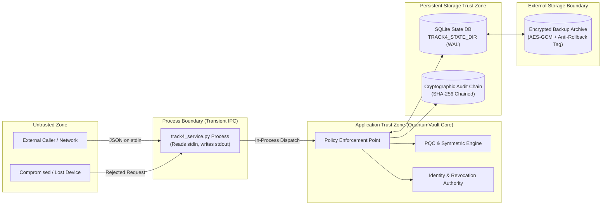
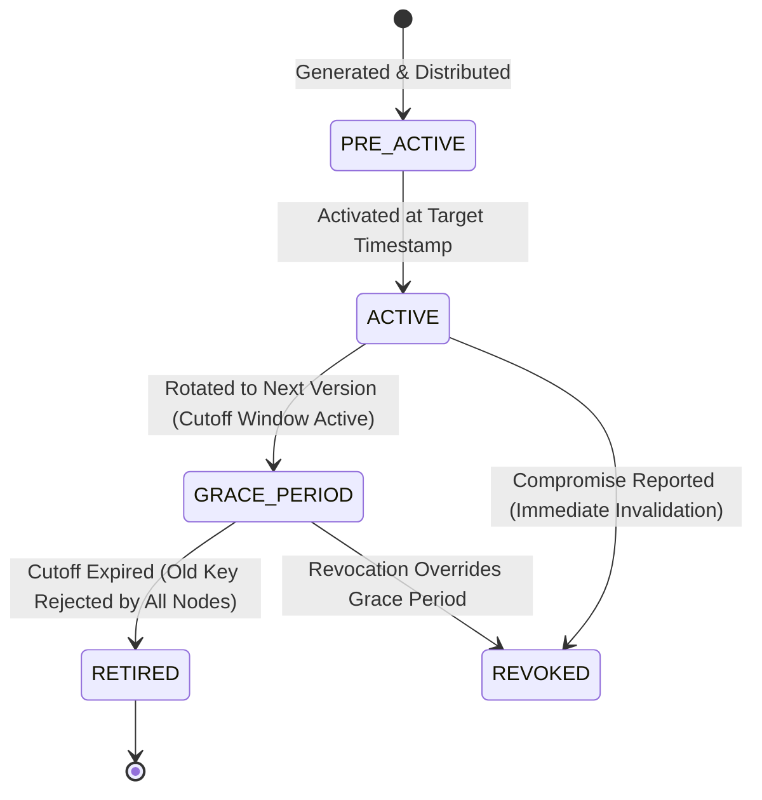

# QuantumVault — Security Architecture Specification
**Hackathon:** Yugaantar DevForge | **Track:** Track 4: "Trust, but verify"  
**Document Status:** Approved Architectural Planning (Phase-U)

---

## 1. Security Architecture Principles

QuantumVault is designed from the ground up according to strict zero-trust and defense-in-depth principles:
1. **Zero-Trust Identity Verification:** All incoming requests are treated as untrusted until explicitly authorized. Never trust client claims or transport metadata.
2. **Fail-Closed Default:** If an authorization decision cannot be verified due to stale cache, disconnected nodes, or database failure, access is unconditionally denied.
3. **Cryptographic Key Separation:** Long-term identity keys, data encryption keys, ephemeral session keys, backup verification keys, and log integrity keys are strictly isolated. No key is reused across distinct security contexts.
4. **Zero-Knowledge Denial:** Denied responses disclose zero information regarding protected content, cryptographic key markers, or internal policy evaluation traces.
5. **Immutable Audit Trail:** Every access request, privilege change, and revocation is irrevocably recorded in a tamper-evident, hash-chained log.
6. **Deterministic Threat Explainability:** Threat detection must be 100% deterministic, auditable, and rule-based. Zero probabilistic black-box AI models.

---

## 2. Explicit Trust Boundaries & Isolation



### Trust Boundary Definitions:
1. **Process Boundary (Harness to Adapter):**
   - The judging harness interacts exclusively through standard input and standard output streams.
   - All input identifiers (`actor`, `asset`, `request_id`, `challenge`, `public_key`) are treated as untrusted, opaque byte streams.
   - The adapter enforces a strict 64 KiB buffer cap, terminates immediately upon output generation, and scrubs stderr to prevent sensitive data leaks.
2. **Policy Enforcement Boundary (Core Engine):**
   - The Policy Enforcement Point (PEP) isolates the cryptographic engine and resource vault from unauthorized callers.
   - Cryptographic encapsulation or decryption is **never executed** before authorization is verified.
3. **Storage Boundary (Host Filesystem):**
   - The host filesystem outside `TRACK4_STATE_DIR` is considered read-only.
   - All state written to disk must survive unexpected process crashes.
4. **Distributed Node Boundary:**
   - Distributed nodes communicate via authenticated messages. A disconnected node transitions to a restricted fail-closed state for sensitive resources.

---

## 3. Identity, Access Management & Revocation Model

### 3.1 Three-Tier Revocation Hierarchy
QuantumVault distinguishes three granular levels of credential invalidation:
1. **Actor-Level Revocation:** Completely disables an identity across all services and nodes (`disabled` list). All active devices, sessions, and permissions belonging to that actor are immediately invalidated.
2. **Device-Level Revocation:** Invalidates a specific compromised or lost device cryptographic binding (e.g., `device-042`). The legitimate owner retains their account, baseline permissions, and access via other registered devices.
3. **Role/Permission Revocation:** Revokes specific administrative or scoped roles (e.g. revoking `report-reader` while maintaining `viewer` access to `catalog`), as demonstrated in practice events `evt-016`-`018` and `evt-021`.

### 3.2 Secure Device Re-Enrollment Protocol
When a device is reported lost:
1. The user or administrator triggers `revoke_device(actor, old_device_id)`.
2. The old device credential is permanently blacklisted across all nodes.
3. To enroll a replacement device (`new_device_id`):
   - The user must authenticate via an alternate verified channel (e.g., recovery key, backup admin approval, or master identity credential).
   - A fresh post-quantum public key is registered for `new_device_id`.
   - The user's historical authorized assets remain accessible, but the old compromised device remains permanently barred.

```mermaid
sequenceDiagram
    autonumber
    actor User as Legitimate Owner (Alex)
    actor Thief as Stolen Device Holder
    participant Auth as QuantumVault IAM
    participant Vault as Resource Vault

    Note over User,Thief: Alex loses Device 1. Thief attempts access.
    User->>Auth: Report Device 1 Lost / Revoke
    Auth->>Auth: Record Device 1 Revoked in State
    
    Thief->>Vault: Read "confidential-file" with Device 1
    Vault->>Auth: Check Device 1 status
    Auth-->>Vault: Device 1 is REVOKED
    Vault-->>Thief: {"decision": "deny"} (Zero-Knowledge)

    Note over User: Alex obtains Device 2 (New Hardware)
    User->>Auth: Enrol Device 2 (Authenticate with Recovery Secret)
    Auth->>Auth: Bind Device 2 to Alex; Old Device 1 stays blacklisted
    Auth-->>User: Enrolment Complete
    
    User->>Vault: Read "confidential-file" with Device 2
    Vault->>Auth: Check Device 2 status
    Auth-->>Vault: Device 2 is AUTHORIZED
    Vault-->>User: {"decision": "allow", "body": "confidential-file"}
```

---

## 4. Cryptographic Key Architecture & Hierarchy

To prevent cascading compromise, QuantumVault enforces strict key separation:

```
[Master State Secret] (Derived from system environment / secure bootstrap)
   │
   ├── [Key-Wrapping Key (KWK)] (AES-256-KW)
   │      └── Wraps and protects Data Encryption Keys (DEKs) at rest.
   │
   ├── [Data Encryption Keys (DEKs)] (AES-256-GCM)
   │      └── Encrypts stored file bodies and message payloads in the vault.
   │
   ├── [Post-Quantum Identity / KEM Keys] (ML-KEM-768)
   │      └── Used for peer-to-peer public key exchange and protected reads.
   │
   ├── [Ephemeral Session Secrets] (32-byte shared secret via KEM encaps)
   │      └── Derived via HKDF-SHA-256; zeroized immediately upon session close.
   │
   ├── [Log Integrity Secret] (HMAC-SHA-256 key)
   │      └── Signs sequential blocks in the audit hash chain.
   │
   └── [Backup Authentication Key] (HMAC-SHA-256 / AES-256-GCM)
          └── Protects offline database archives against tampering.
```

### Key Versioning & Lifecycle State Machine
Keys transition through four deterministic states:

- **Active Window:** The current key is used for all new encryption and read operations.
- **Grace Period:** During key rotation, existing in-flight transfers may complete with the predecessor key within a strict time window (e.g. 60 seconds).
- **Cutoff Enforcement:** After the cutoff timestamp, every node rejects requests signed or encrypted with the old key.
- **Revocation Override:** A revocation event unconditionally terminates any active grace period, forcing immediate denial.

---

## 5. Tamper-Evident Audit Logging Architecture

### 5.1 Cryptographic Hash Chaining
Audit logs are structured as a cryptographic block chain:
$$\text{Entry}_N = \{\text{Seq}_N, \text{Timestamp}_N, \text{Actor}_N, \text{Action}_N, \text{Resource}_N, \text{Decision}_N, \text{Reason}_N, \text{PrevHash}_{N-1}\}$$
$$\text{CurrentHash}_N = \text{SHA-256}(\text{PrevHash}_{N-1} \parallel \text{CanonicalJSON}(\text{Entry}_N))$$

### 5.2 Protection Against Log Manipulation
1. **Injection Prevention:** All log fields are serialized using strict JSON encoding. Control characters (`\r`, `\n`, `\0`, `\b`) are escaped, preventing an attacker from crafting synthetic multi-line entries.
2. **Deletion & Reordering Detection:** Verifying the hash chain from $\text{Entry}_0$ to $\text{Entry}_N$ detects any deleted, inserted, or reordered records.
3. **Truncation Detection:** Periodic state checkpoints record the latest sequence number and hash digest in the transactional database state. If an attacker truncates recent logs, the sequence counter disparity is immediately flagged.

---

## 6. Multi-Node Distributed Security & Partition Resilience

In a multi-node cluster (Nodes A, B, and C):
- **Monotonic Version Vectors:** Every revocation and role update increments the global cluster epoch counter.
- **Partition Behavior (Fail-Closed):** If Node C loses connectivity to the cluster coordinator:
  - Read requests for non-sensitive public catalog items may proceed.
  - Read requests for protected resources require verifying state freshness. If the local node's last successful cluster synchronization heartbeat exceeds a defined threshold (e.g. 5,000 ms), the node **fails closed** and denies access with `decision: "deny"`.
  - Stale nodes never gamble on out-of-date revocation tables.

---

## 7. Deterministic Threat Detection Architecture

The threat detection engine is strictly deterministic and auditable:
- **Approval Matching Engine:** Verifies every administrative action against `approvals.json`:
  - Subject identity matches.
  - Requested role matches.
  - Target operation matches.
  - Target scope (service nodes) matches.
  - Timestamp falls within `[valid_from_utc, valid_until_utc)`.
- **Graph-Based Service Path Anomaly:**
  - Maintains a directed graph of permitted service communications.
  - Flags any sequence traversing unauthorized edges (`reports` $\to$ `billing` $\to$ `archive` $\to$ `identity`).
- **Explainability Requirement:** Every alert emitted by QuantumVault produces a human-readable diagnosis identifying:
  - The offending identity.
  - The violating event IDs.
  - The exact authorization rule or graph edge breached.
  - Whether requests were blocked or allowed.
