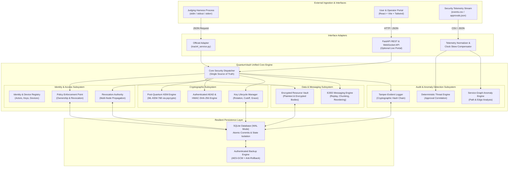
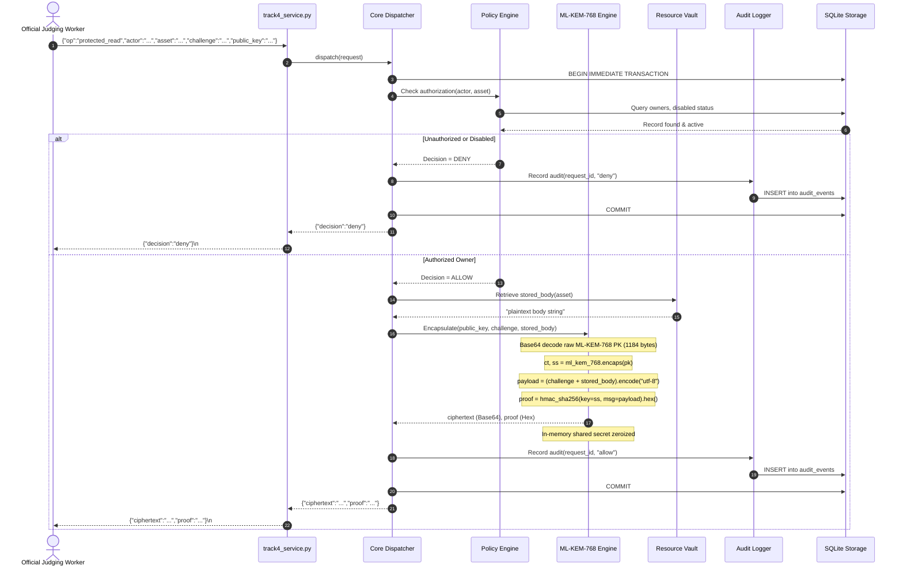
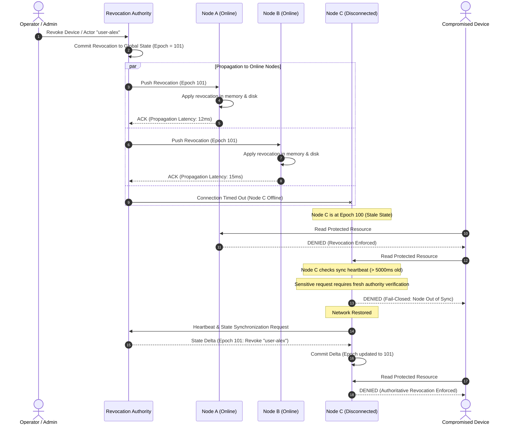

# QuantumVault — System Architecture Specification
**Hackathon:** Yugaantar DevForge | **Track:** Track 4: "Trust, but verify"  
**Document Status:** Approved Architectural Planning (Phase-U)

---

## 1. Architectural Overview

QuantumVault is architectured as a modular, unified security platform. Rather than splitting the system into disconnected microservices that increase deployment complexity and fragility, QuantumVault adopts a **clean modular core** architecture.

A single authoritative core security engine powers:
1. The **Official Headless Adapter** (`track4_service.py`) executed by the automated judging worker.
2. The **Distributed Multi-Node Cluster Simulator** executing multi-node revocation and crash recovery tests.
3. The **Interactive Operator & User Web API** (`FastAPI` backend serving the React portal).

This guarantees that the exact same authorization, cryptographic, and persistence rules are exercised during both automated evaluation and live interactive demonstration.

---

## 2. High-Level System Architecture Diagram



---

## 3. Subsystem Decomposition & Responsibilities

### 3.1 Interface Layer
1. **Official Headless Adapter (`track4_service.py`):**
   - Implements the strict `docs/adapter-v1.md` protocol.
   - Spawns per request, parses standard input JSON to EOF, delegates directly to `core.dispatch()`, writes the exact output JSON to stdout, and terminates with exit code 0.
   - Masks internal errors to prevent information leakage to stderr.
2. **Interactive Web API (`api/`):**
   - Lightweight FastAPI server providing REST endpoints for the operator dashboard and user vault.
   - Exposes zero bypasses; routes every action through the exact same policy and crypto functions as the adapter.
3. **Telemetry Ingestion Pipeline (`telemetry/`):**
   - Ingests raw batch or streaming event logs.
   - Calculates corrected timestamps: `corrected_time = event_time - clock_offset`.
   - Maintains original arrival order alongside chronological event order.

### 3.2 Unified Core Security Engine
1. **Core Dispatcher (`core/dispatcher.py`):**
   - Dispatches requests for `setup`, `read`, `revoke`, `audit`, and `protected_read`.
   - Coordinates transactional boundaries across storage, policy enforcement, and audit recording.
2. **Policy Enforcement Point (PEP) & Decision Point (PDP) (`iam/policy.py`):**
   - Enforces the invariant: An access request is granted **if and only if** `actor not in disabled AND asset in owners AND owners[asset] == actor`.
   - Completely omits the body from responses when denied (Fail-Closed Denial).
3. **Post-Quantum Cryptographic Engine (`crypto/pqc.py`):**
   - Interfaces directly with `pqcrypto.kem.ml_kem_768`.
   - Implements Base64 public key decoding, key validation, post-quantum encapsulation (`encaps()`), shared secret extraction, and lowercase hexadecimal HMAC-SHA-256 generation over `challenge + stored_body`.
4. **Key Lifecycle Manager (`crypto/key_lifecycle.py`):**
   - Implements 3-state key versioning: `ACTIVE`, `GRACE_PERIOD`, and `RETIRED`.
   - Enforces key retirement cutoffs. Grace periods apply strictly to existing established transfers; revocation immediately overrides any grace period.
5. **Multi-Node Synchronization & Revocation Authority (`distributed/cluster.py`):**
   - Simulates distributed service nodes (Node A, Node B, Node C).
   - Propagates revocations using monotonic state versioning.
   - Implements fail-closed security for disconnected nodes attempting sensitive access.
6. **Encrypted Resource Vault (`vault/`):**
   - Manages secure storage of assets, metadata, ownership bindings, and encrypted payloads.
7. **Secure End-to-End Messaging Engine (`messaging/`):**
   - Provides chunked framing, replay-resistant sequence numbers, recipient key binding, and out-of-order reassembly.
8. **Tamper-Evident Audit Logger (`audit/`):**
   - Appends audit events to an immutable cryptographic hash chain where `Hash_N = SHA-256(Hash_{N-1} || EventData_N)`.
   - Precludes log injection via structured JSON serialization and control-character sanitization.
9. **Deterministic Threat Detector & Service Graph Engine (`detection/`):**
   - Ingests change-management approvals (`approvals.json`) and matches subject, role, validity window, and scope.
   - Identifies rogue privilege changes (`evt-008`).
   - Tracks cross-service transitions on a directed graph; flags anomalous paths (`reports` -> `billing` -> `archive` -> `identity`).
10. **Authenticated Backup & Recovery Engine (`backup/`):**
    - Creates AES-256-GCM encrypted database snapshots with HMAC-SHA-256 integrity tags.
    - Maintains a monotonic state epoch counter to detect and reject rollback attacks using outdated backups.

---

## 4. End-to-End Sequence Diagrams

### 4.1 Protected Read Operation (Post-Quantum KEM & HMAC Proof)



### 4.2 Multi-Node Revocation & Disconnected Node Fail-Closed Flow



---

## 5. Source Directory & File Layout Plan

```
e:\ps4-oncemore/
├── details.txt                      # Complete toolkit technical reference (Phase-U artifact)
├── threat-model.json                # Root metadata recognized by official worker
├── track4_service.py                # Single mandatory judging entrypoint
├── README.md                        # Submission setup, architecture, and reproduction manual
├── requirements.txt                 # Manifest of standard dependencies
├── planning/                        # 16 Comprehensive Phase-U architectural specifications
│   ├── PROJECT_UNDERSTANDING.md
│   ├── REQUIREMENTS_TRACEABILITY.md
│   ├── SYSTEM_ARCHITECTURE.md
│   ├── SECURITY_ARCHITECTURE.md
│   ├── CRYPTOGRAPHIC_DESIGN.md
│   ├── DATABASE_SCHEMA.md
│   ├── API_AND_ADAPTER_CONTRACT.md
│   ├── OFFLINE_AND_RECOVERY_STRATEGY.md
│   ├── THREAT_MODEL.md
│   ├── EDGE_CASE_MATRIX.md
│   ├── THREAT_DETECTION_DESIGN.md
│   ├── TEST_CASE_MATRIX.md
│   ├── FRONTEND_BLUEPRINT.md
│   ├── DEPENDENCY_COMPATIBILITY.md
│   ├── IMPLEMENTATION_ROADMAP.md
│   └── DEMO_AND_EVALUATION_PLAN.md
├── quantumvault/                    # Unified Core Application Package
│   ├── __init__.py
│   ├── core/                        # Core dispatching & lifecycle
│   │   ├── __init__.py
│   │   ├── dispatcher.py            # Unified request router
│   │   └── config.py                # State directory and environment resolver
│   ├── crypto/                      # Cryptographic subsystem
│   │   ├── __init__.py
│   │   ├── pqc_kem.py               # ML-KEM-768 wrapper (pqcrypto v0.4.0)
│   │   ├── hmac_proof.py            # HMAC-SHA-256 proof engine
│   │   ├── aead.py                  # AES-256-GCM symmetric envelope
│   │   └── key_manager.py           # Key lifecycle, rotation & cutoff
│   ├── iam/                         # Identity, devices & access control
│   │   ├── __init__.py
│   │   ├── policy.py                # PDP / PEP authorization engine
│   │   ├── identity.py              # User & actor state
│   │   └── device.py                # Device registration & re-enrollment
│   ├── vault/                       # Secure resource vault
│   │   ├── __init__.py
│   │   └── resource_vault.py        # Asset storage and confidentiality
│   ├── messaging/                   # Secure communication engine
│   │   ├── __init__.py
│   │   ├── e2ee.py                  # Ephemeral E2EE messaging protocol
│   │   └── transport.py             # Chunking, reassembly, reordering
│   ├── distributed/                 # Multi-node cluster simulation
│   │   ├── __init__.py
│   │   ├── cluster.py               # Node coordinator & sync
│   │   └── node.py                  # Individual simulated node instance
│   ├── audit/                       # Tamper-evident audit logging
│   │   ├── __init__.py
│   │   └── logger.py                # Hash-chained immutable log engine
│   ├── detection/                   # Explainable threat detection
│   │   ├── __init__.py
│   │   ├── engine.py                # Rule-based approval correlator
│   │   ├── service_graph.py         # Directed graph lateral movement detector
│   │   └── clock.py                 # Telemetry normalizer & clock compensator
│   ├── backup/                      # Authenticated backup & restore
│   │   ├── __init__.py
│   │   └── backup_manager.py        # Encrypted snapshots & anti-rollback
│   ├── storage/                     # Transactional persistence layer
│   │   ├── __init__.py
│   │   ├── db.py                    # SQLite connection & WAL management
│   │   └── schema.sql               # Relational DDL definitions
│   └── testing/                     # Security lab & fault injector
│       ├── __init__.py
│       └── lab.py                   # 22 Test laboratory execution engine
├── tests/                           # Automated test suites
│   ├── __init__.py
│   ├── test_adapter_conformance.py  # Standalone adapter conformance tests
│   ├── test_pqc_crypto.py           # ML-KEM-768 round-trip verification
│   ├── test_objectives.py           # Automated tests for 12 core goals
│   └── test_fault_injection.py      # Stress & failure scenarios
└── ui/                              # Frontend Portal (React + Vite + Tailwind)
    ├── package.json
    ├── vite.config.js
    └── src/
        ├── components/              # Reusable UI widgets
        ├── pages/                   # User & Operator views
        └── App.jsx
```
