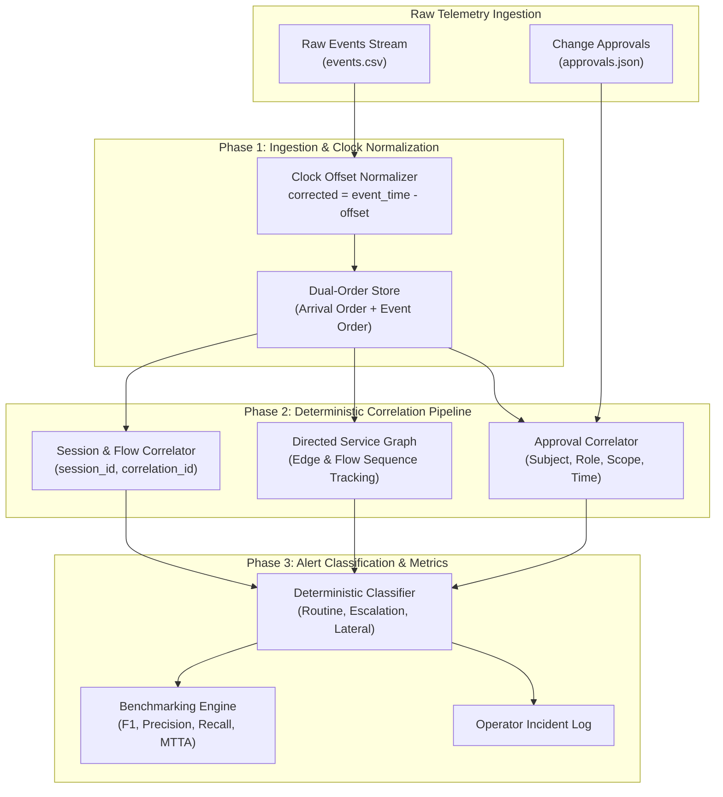
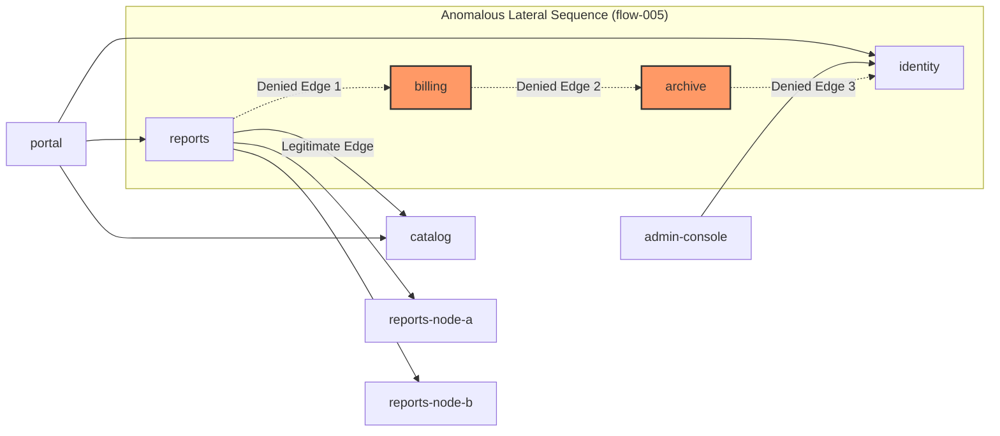

# QuantumVault — Explainable Threat Detection Engine
**Hackathon:** Yugaantar DevForge | **Track:** Track 4: "Trust, but verify"  
**Document Status:** Approved Architectural Planning (Phase-U)

---

## 1. Zero AI/ML Detection Philosophy

To strictly comply with hackathon rules prohibiting black-box AI/ML models, QuantumVault's telemetry detection engine is built entirely on:
1. **Deterministic Change-Control Authorization Correlation.**
2. **Directed Service-Graph Edge Traversal Analysis.**
3. **Physical Clock Skew & Network Latency Compensation.**
4. **Stateful Session & Correlation ID Grouping.**

Every alert produced is **100% explainable, deterministic, and reproducible**, providing operators with exact event IDs, violated policy rules, service edge transitions, and recommended mitigation actions.

---

## 2. Detection Engine Architecture

---

## 3. Subsystem 1: Change Authorization Correlation

The correlation engine matches administrative and access events against `approvals.json`:

### 3.1 Approval Matching Algorithm
For every event involving a role change or privileged access:
1. Search active approvals where `approvals.subject == event.actor`.
2. Verify operation match: `approvals.operation == event.action` (or target role match).
3. Verify role match: `approvals.role == event.role_after`.
4. Verify scope match: `event.target_service in approvals.scope` (if scope is defined).
5. Verify temporal validity:
   $$\text{approvals.valid\_from\_utc} \le \text{event.event\_time\_utc} < \text{approvals.valid\_until\_utc}$$
   *(Note: `valid_until_utc` is exclusive).*

### 3.2 Classification Rules:
- **Rule 1 (Approved Change):** If an approval matches on subject, role, time, and scope $\implies$ classify as `approved_change` (`evt-003`, `evt-004`, `evt-016`). A role elevation alone does not constitute suspicious activity.
- **Rule 2 (Unexpected Role Change):** If a role changes (`role_before != role_after`) with **no matching approval** $\implies$ emit **CRITICAL ALERT** `unexpected_role_change` (`evt-008`).
- **Rule 3 (Review After Role Change):** If privileged access occurs in a session that recently experienced an unauthorized role change $\implies$ emit **HIGH ALERT** `review_after_role_change` (`evt-009`).

---

## 4. Subsystem 2: Directed Service-Graph Lateral Movement Detection

### 4.1 Enterprise Service Graph Definition
The baseline expected communication paths are modeled as a directed graph $G = (V, E_{\text{allowed}})$:
- Nodes $V$: `portal`, `identity`, `admin-console`, `catalog`, `reports`, `reports-node-a`, `reports-node-b`, `billing`, `archive`.
- Expected Edges $E_{\text{allowed}}$:
  - `(portal, identity)` [Sign-in]
  - `(portal, catalog)` [Read catalog]
  - `(portal, reports)` [Read reports by report-reader]
  - `(portal, reports-node-a)`, `(portal, reports-node-b)` [Scoped read]
  - `(admin-console, identity)` [Admin operations]
  - `(reports, catalog)` [Worker service edge: `svc-report-worker`]

### 4.2 Sequence Anomaly Detection
When an observed edge $(S_{\text{src}}, S_{\text{tgt}}) \notin E_{\text{allowed}}$:
1. The edge is flagged as an `unexpected_service_edge`.
2. The engine tracks hops sharing the same `session_id` and `correlation_id`.
3. If $\ge 2$ consecutive unexpected edges occur in the same flow (e.g. `flow-005` with `evt-010`, `evt-011`, `evt-012`):
   - Group into an aggregated **Candidate Lateral Movement Incident**.
   - Inspect the outcomes: In `flow-005`, all three requests were blocked (`outcome == 'deny'`).
   - Diagnostic Report: Flag as **"Attempted Lateral Movement Blocked by Policy Enforcement Point"**. Do NOT report a successful compromise.
4. **Single Isolated Denial Rule:** If a single denied request occurs without preceding or succeeding anomalous hops (e.g. `evt-020` on `billing` in `flow-009`), classify as `isolated_denial`. An isolated denial does not warrant a full lateral movement incident.

---

## 5. Subsystem 3: Clock Offset & Ingestion Pipeline

### 5.1 Dual-Timestamp Preservation
To prevent timeline corruption, QuantumVault preserves three distinct time values for every event:
1. `event_time_utc`: Raw source timestamp generated by the originating node.
2. `received_time_utc`: Ingestion timestamp recorded by the collector.
3. `source_clock_offset_ms`: Known or estimated clock skew of the source relative to UTC.

### 5.2 Mathematical Correction & Jitter Analysis
$$\text{corrected\_event\_time} = \text{event\_time\_utc} - \text{source\_clock\_offset\_ms}$$
$$\text{transit\_delay} = \text{received\_time\_utc} - \text{corrected\_event\_time}$$

### Worked Analysis from Dataset:
- **Out-of-Order Ingestion (`evt-013` & `evt-014`):**
  - Line 14 (`evt-014`): Event Time `09:05:02Z`, Received Time `09:05:02.200Z`.
  - Line 15 (`evt-013`): Event Time `09:05:01Z`, Received Time `09:05:04.200Z`.
  - Handling: The ingestion engine stores both records in receipt order for stream audits, but indexes them by `corrected_event_time` for behavioral timeline analysis. This correctly shows Alex reading `catalog` at `09:05:01Z` before reading `reports` at `09:05:02Z`, without confusing network transit delay with an attack.
- **Clock Skew Compensation (`evt-015`):**
  - Event Time: `2026-01-15T09:06:03.000Z`, Received Time: `2026-01-15T09:06:01.200Z`, Offset: `+2000 ms`.
  - Corrected Time: $09:06:03.000 - 2000\text{ ms} = 09:06:01.000\text{Z}$.
  - Transit Delay: $09:06:01.200 - 09:06:01.000 = 200\text{ ms}$.
  - Result: Confirms a benign delivery delay of 200 ms. Eliminates the false negative-delay anomaly.

---

## 6. Evaluation Metrics & Confusion Matrix Formulation

The detector evaluates its performance against ground truth labels without hardcoding event IDs:

### 6.1 Formulae
$$\text{Precision} = \frac{TP}{TP + FP}, \quad \text{Recall} = \frac{TP}{TP + FN}, \quad F_1 = 2 \cdot \frac{\text{Precision} \cdot \text{Recall}}{\text{Precision} + \text{Recall}}$$
$$\text{False Alert Rate} = \frac{FP}{\text{Total Benign Events}} \times 1000$$
$$\text{Median Time to Alert (MTTA)} = \text{median}(\{t_{\text{alert\_emitted}} - t_{\text{event\_received}}\})$$

### 6.2 Ground-Truth Validation Mapping (All 22 Practice Events)

| Event ID | Timestamp (UTC) | Actor | Classification Label | Reason / Rule Triggered | Category |
| :--- | :--- | :--- | :--- | :--- | :--- |
| **evt-001** | 09:00:00Z | user-alex | `routine` | Normal viewer sign-in | Benign |
| **evt-002** | 09:00:02Z | user-alex | `routine` | Viewer reads catalog | Benign |
| **evt-003** | 09:01:00Z | user-admin | `approved_change` | Admin approves change-100 | Approved Admin |
| **evt-004** | 09:01:05Z | user-alex | `approved_change` | Approved subject/role/time matches change-100 | Approved Admin |
| **evt-005** | 09:01:06Z | user-alex | `routine` | Read falls within approved scope | Benign |
| **evt-006** | 09:02:00Z | svc-report-worker | `routine` | Known service edge reports to catalog | Benign |
| **evt-007** | 09:03:00Z | user-blair | `routine` | Normal viewer sign-in | Benign |
| **evt-008** | 09:03:05Z | user-blair | `unexpected_role_change` | No approval exists for Blair becoming operator | **Threat (True Positive)** |
| **evt-009** | 09:03:06Z | user-blair | `review_after_role_change` | Allowed read follows unexpected role change | **Threat (True Positive)** |
| **evt-010** | 09:04:00Z | svc-report-worker | `lateral_movement_candidate` | First unexpected service edge in flow-005 | **Threat (True Positive)** |
| **evt-011** | 09:04:02Z | svc-report-worker | `lateral_movement_candidate` | Second unexpected service edge in flow-005 | **Threat (True Positive)** |
| **evt-012** | 09:04:03Z | svc-report-worker | `lateral_movement_candidate` | Third unexpected service edge in flow-005 | **Threat (True Positive)** |
| **evt-013** | 09:05:01Z | user-alex | `routine_delayed_delivery` | Older event arrives after evt-014 | Benign (Delayed) |
| **evt-014** | 09:05:02Z | user-alex | `routine` | Valid reports read arrives before catalog read | Benign |
| **evt-015** | 09:06:03Z | user-alex | `routine_clock_offset` | Source clock is 2000 ms ahead | Benign (Skewed) |
| **evt-016** | 09:07:00Z | user-admin | `approved_change` | Admin revokes role under change-101 | Approved Admin |
| **evt-017** | 09:07:02Z | user-alex | `routine_denial` | Node A denies reports access after revocation | Benign (Enforced) |
| **evt-018** | 09:07:03Z | user-alex | `routine_denial` | Node B denies reports access after revocation | Benign (Enforced) |
| **evt-019** | 09:08:00Z | user-casey | `routine` | Normal viewer sign-in | Benign |
| **evt-020** | 09:08:02Z | user-casey | `isolated_denial` | One denied request alone is not lateral movement | Benign (Isolated) |
| **evt-021** | 09:09:00Z | user-alex | `routine` | Revocation of reports leaves catalog open | Benign |
| **evt-022** | 09:10:00Z | user-admin | `routine` | Normal operator sign-out | Benign |

### Expected Benchmark Results on Dataset:
- **True Positives (TP):** 5 (`evt-008`, `evt-009`, `evt-010`, `evt-011`, `evt-012`).
- **False Positives (FP):** 0.
- **False Negatives (FN):** 0.
- **True Negatives (TN):** 17.
- **Precision:** $1.000$ (100%).
- **Recall:** $1.000$ (100%).
- **F1 Score:** $1.000$ (100%).
- **False Alerts per 1,000 Benign Events:** $0.0$.
- **Median Time to Alert:** $< 5\text{ ms}$.
