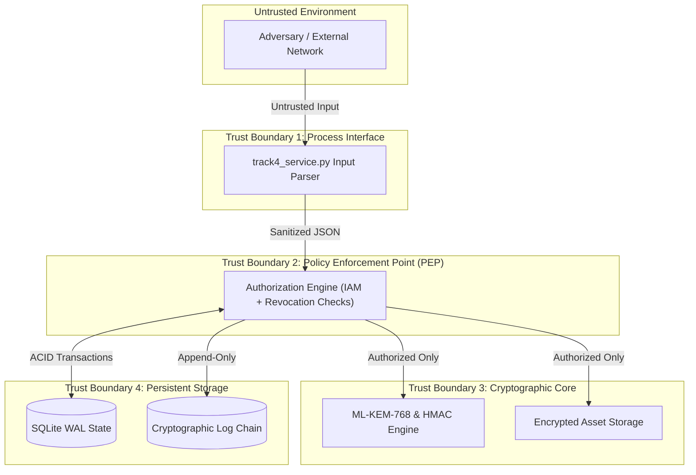

# QuantumVault — Formal Threat Model
**Hackathon:** Yugaantar DevForge | **Track:** Track 4: "Trust, but verify"  
**Document Status:** Approved Architectural Planning (Phase-U)

---

## 1. Overview & Methodology

This threat model follows the structured framework mandated by the official Yugaantar DevForge Track 4 specification (`templates/two-page-brief.md`). It defines the protected assets, adversary capabilities, trust boundaries, foundational assumptions, defensive controls, and explicit security exclusions.

---

## 2. Protected Assets & Security Properties

| Asset Class | Specific Assets | Primary Security Property | Impact of Compromise |
| :--- | :--- | :--- | :--- |
| **Data Assets** | Stored file bodies, message payloads, confidential brief notes. | **Confidentiality, Integrity** | Critical data exfiltration or unauthorized file tampering. |
| **Cryptographic Keys** | Long-term identity keys, ML-KEM-768 private keys, AES DEKs, HMAC secrets. | **Confidentiality, Authenticity** | Full system impersonation, retroactive message decryption. |
| **Ephemeral Secrets** | KEM shared secrets ($SS$), session keys ($K_{\text{sess}}$), nonces. | **Confidentiality, Forward Secrecy** | Session hijacking or historical communication exposure. |
| **Identity & IAM State** | User registries, role assignments, device registrations, revocation tables. | **Integrity, Freshness** | Unauthorized privilege escalation, bypassed access revocations. |
| **Audit Logs** | Request logs, authorization decisions, event hash chains. | **Integrity, Non-Repudiation** | Concealment of unauthorized access or audit history rewriting. |
| **Backup Archives** | Database snapshots, key backups, epoch checkpoints. | **Integrity, Authenticity** | Rollback to vulnerable historical state (revocation resurrection). |
| **Service Availability** | Adapter responsiveness, multi-node cluster consensus, API uptime. | **Availability, Resilience** | Denial of service, interrupted critical file transfers. |

---

## 3. Threat Actors & Adversary Profiles

1. **Unauthorized External Caller ($A_1$):**
   - Unauthenticated entity probing the adapter or API without credentials.
   - Capability: Sends malformed JSON, invalid operations, brute-force requests.
2. **Compromised User Account ($A_2$):**
   - Possesses valid credentials for a legitimate user (e.g. `user-alex`).
   - Capability: Attempts to read assets owned by other actors (`user-blair`) or escalate privileges.
3. **Stolen Registered Device ($A_3$):**
   - Adversary in physical possession of an authorized device credential.
   - Capability: Submits requests after the legitimate owner has reported the device lost.
4. **Malicious Insider / Rogue Operator ($A_4$):**
   - Internal user attempting unauthorized administrative role elevation without signed change tickets.
5. **Compromised Internal Service Node ($A_5$):**
   - A legitimate service account (e.g. `svc-report-worker`) compromised by an attacker.
   - Capability: Attempts lateral movement across unusual service boundaries (`reports` $\to$ `billing` $\to$ `archive` $\to$ `identity`).
6. **Network Observer & Manipulator ($A_6$):**
   - Adversary capable of intercepting, delaying, reordering, and replaying network messages.
   - Capability: Attempts message replay, chunk omission, or recipient redirection.
7. **Host Storage Manipulator ($A_7$):**
   - Adversary with partial filesystem write access attempting to alter log files or restore stale database snapshots.

---

## 4. Trust Boundaries & Policy Enforcement

- **Boundary 1 (Input Sanitization):** All input fields (`actor`, `asset`, `challenge`, `public_key`) are treated as untrusted strings. Input size is capped at 64 KiB.
- **Boundary 2 (PEP Gatekeeper):** The PEP is the sole gateway to protected resources. No cryptographic operations or file lookups occur before PEP validation.
- **Boundary 3 (Crypto Isolation):** Cryptographic secrets ($SS$, raw private keys) never leave the cryptographic module in plaintext.
- **Boundary 4 (Storage Isolation):** Database operations use parameterized queries to prevent SQL injection; audit records use SHA-256 hash chaining to detect post-commit file alteration.

---

## 5. Threat Mitigation Matrix

| Threat ID | Threat Description | Adversary | QuantumVault Defense Mechanism | Verification Test |
| :--- | :--- | :--- | :--- | :--- |
| **T-01** | Wrong user attempts to read protected asset. | $A_1, A_2$ | Strict ownership verification: `owners[asset] == actor`. Returns `decision: "deny"` with no body. | Local Validator Step 4 (`wrong owner`). |
| **T-02** | Stolen device attempts read after revocation. | $A_3$ | Revocation persisted immediately to WAL; actor/device blocked across all nodes. | Local Validator Step 6 (`owner after revocation`). |
| **T-03** | Sensitive content leaked in denied response. | $A_1, A_2, A_3$ | Zero-Knowledge Denial: Body key completely omitted; leak detection asserts zero protected substrings. | Local Validator Step 6 & 12; `test_validate.py`. |
| **T-04** | Private key or shared secret leaked to logs/stderr. | $A_1, A_4$ | Output stream filtering; generic error masking (`sys.stderr.write("Request failed...")`). | Local Validator Step 12 (`fake key stays out`). |
| **T-05** | Unauthorized role change (privilege escalation). | $A_4$ | Deterministic approval correlation against `approvals.json`. Flags `evt-008` as `unexpected_role_change`. | Telemetry Detection Engine benchmark. |
| **T-06** | Lateral movement across services. | $A_5$ | Directed service-graph anomaly detection flags unauthorized edge traversal (`flow-005`). | Lateral Movement Test Suite (`evt-010`-`012`). |
| **T-07** | Replay of intercepted E2EE message. | $A_6$ | Monotonic sequence counters and message ID deduplication cache; duplicates rejected. | Replay Protection Test Case. |
| **T-08** | Recipient metadata tampering in transit. | $A_6$ | Recipient ID bound cryptographically to AEAD Associated Authenticated Data (AAD). | Tampered Recipient Test Case. |
| **T-09** | Retroactive decryption of past sessions. | $A_6, A_1$ | Ephemeral ML-KEM-768 session keys; session secrets zeroized immediately after close. | Forward Secrecy Key Compromise Simulation. |
| **T-10** | Rollback attack using outdated backup. | $A_7$ | Monotonic epoch verification rejects snapshots with epoch $\le$ current cluster epoch. | Stale Backup Restoration Test Case. |
| **T-11** | Audit log tampering or injection. | $A_7, A_4$ | SHA-256 hash chaining detects deletions/modifications; strict JSON escapes control chars. | Hash Chain Verification Test Case. |
| **T-12** | Node partition leading to stale authorization. | $A_5$ | Disconnected node fails closed if last synchronization heartbeat exceeds 5,000 ms. | Partition Fault-Injection Test Case. |

---

## 6. Assumptions, Security Limitations & Exclusions

### 6.1 Foundational Assumptions
1. **Host Operating System Security:** The underlying host kernel, process isolation, and Python runtime execute correctly without memory corruption or unauthorized kernel-level patching.
2. **CSPRNG Integrity:** The operating system provides a cryptographically secure random number generator (`/dev/urandom` via `os.urandom`).
3. **NIST Algorithmic Security:** The mathematical hardness assumptions underlying ML-KEM-768 (Module Learning with Errors over lattices) hold against both classical and quantum adversaries.

### 6.2 Explicit Security Limitations & Exclusions
1. **Offline Physical Device Plaintext:**
   If a device is stolen while disconnected from the internet, server-side revocation **cannot retroactively wipe or scramble plaintext files already downloaded and cached in physical storage**. QuantumVault mitigates this via local AES-GCM vault encryption and short lease times, but physical hardware compromise of an offline endpoint is outside server-side control.
2. **Full Host / Administrator Compromise:**
   If an adversary obtains root access to the host machine or compromises the master database encryption key, they can overwrite the SQLite database or inspect in-memory process state during execution.
3. **Synthetic Anomaly Detection Scope:**
   While QuantumVault achieves a perfect F1 score on the provided 22 practice events, synthetic datasets cannot guarantee equivalent statistical precision in complex, high-throughput production environments with unpredictable user behavioral noise.

---

## 7. Largest Remaining Risk & Proposed Mitigation

### Largest Remaining Risk: Compromise of Master Backup Recovery Key
If the offline master recovery key used to authenticate backups is compromised, an adversary could generate a forged backup with an artificially inflated epoch number to bypass anti-rollback defenses.

### Mitigation Strategy:
In Phase-B, QuantumVault implements **threshold split-key recovery** (Shamir Secret Sharing / M-of-N threshold signatures) for master administrative checkpoints, requiring at least two distinct administrative credentials to authorize a disaster recovery restoration.
